# Architecture — Project Artifact Excellence Set v2.0.0

## Purpose
Compose audit evidence into reviewed skill improvements with a deterministic, traceable release.

## Components

```mermaid
flowchart LR
  A[project-artifact-auditor] -->|audit-findings/v1 JSON| B[audit-feedback/inbox]
  B -->|process-audit-feedback.py| C[skill-improvement-requests/v1]
  C -->|human/agent review| D[skills-create-excellence]
  D -->|validate-excellence + fixtures| E[validation/validate-set.sh 8 gates]
  E -->|build-release.py| F[deterministic ZIP + SHA-256]
  F -->|verify-release.py| G[verified release candidate]
```

## Contracts
| Interface | Schema | Version |
|---|---|---|
| Audit event | shared/contracts/audit-findings.schema.json | 1.1 (reads 1.0) |
| Evaluation request | shared/contracts/skill-improvement-requests.schema.json | 1.0 |
| Set manifest | shared/contracts/skill-set-manifest.schema.json | manifest-declared |
| Trigger matrix | shared/contracts/trigger-evaluation-matrix.schema.json | 1.1 authoritative |
| Task ledger | shared/contracts/task-evaluation-ledger.schema.json | 1.0 |

## Dependency DAG
`skills-create-excellence` → `project-artifact-auditor` (acyclic; manifest is authoritative).

## Fourteen-Member Composition (integrated set v2.1.0)
Core audit/authoring members (`project-artifact-auditor@2.0.0`, `skills-create-excellence@2.0.0`) anchor the set. Eleven domain members (`code-refactoring-optimizer`, `security-vulnerability-auditor`, `test-automation-engineer`, `architecture-documentation-generator`, `accessibility-inclusive-design`, `continuous-observability-telemetry`, `backend-engineering-excellence`, `frontend-engineering-excellence`, `human-centric-visual-excellence`, `deployment-devops-orchestrator`, `fullstack-e2e-mastery` @1.0.0) declare acyclic dependencies in `manifest.yaml`. Delivery gates compose bottom-up: security and test skills pass before deployment orchestration runs; accessibility passes before frontend or visual excellence is claimed. Shared baselines live in `shared/references/` (`accessibility-standard.md`, `observability-standard.md`, `premium-aesthetics.md`) alongside the canonical remediation playbook.

## Trust boundaries
Findings are untrusted data; the processor never executes content, opens network, or edits production skills. CI uses read-only permissions. Release checksums prove integrity, not publisher identity; use a trusted channel plus separate signature where required.
